<div align="center">


<br>

[](LICENSE)


**[Quick start](#quick-start) · [See it](#see-it) · [How it works](#how-it-works) · [Results](#results) · [Docs](#documentation) · [Limits](#honest-limits)**

</div>

<br>

**GraphQL Sentinel is an open-source security gateway that reads the GraphQL _operation_, not just the HTTP request.**
It parses every query into an AST, resolves fragments, scores the abuse risk with rules you can read plus a model you can check,
and answers **ALLOW**, **THROTTLE** or **BLOCK** before anything reaches your API. Every decision is stored with the rules and
numbers behind it.

A request log shows one small `POST`. The danger is inside it: a 434-byte document of eight fragments that expands to
**16,403 fields**, sixty aliased logins in one request, a query ten levels deep. Depth limits and per-IP rate limits cannot tell
those apart from a busy dashboard; Sentinel measures what the server would actually execute.

<br>

## See it


<sub>Recorded by running each operation through the shipped engine (`scripts/export_demo_samples.py`), not mocked.</sub>

<br>

<table>
  <tr>
    <td width="50%">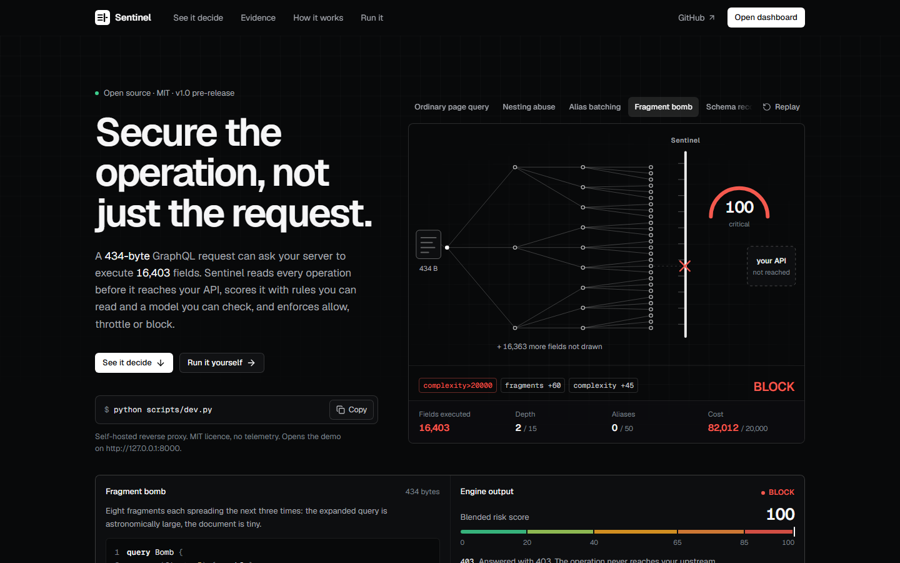<br><sub><b>Landing page</b>: an animated stage that replays real engine decisions on recorded operations.</sub></td>
    <td width="50%">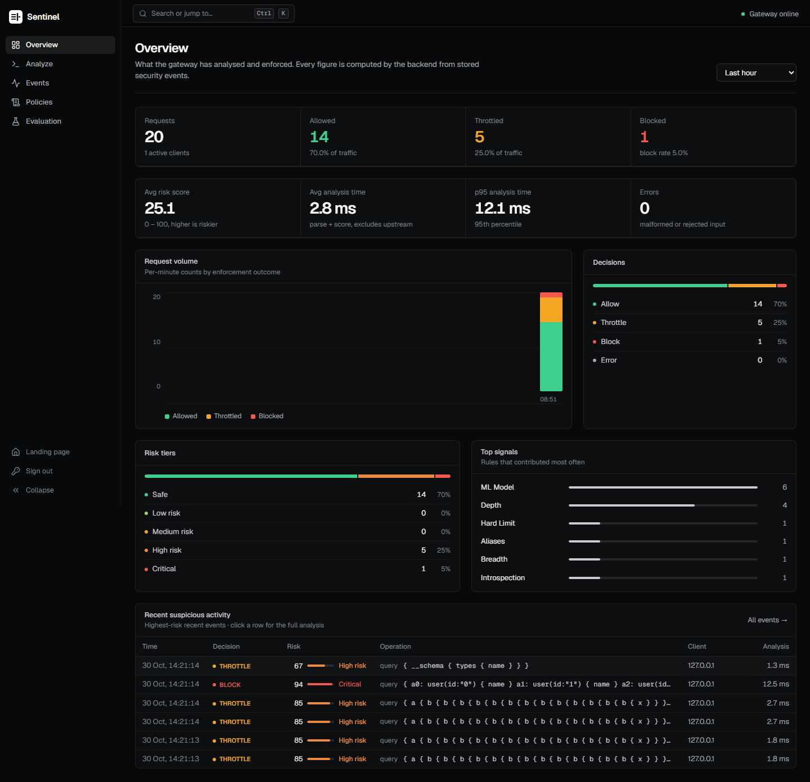<br><sub><b>Overview</b>: decisions, risk tiers, latency and top signals, computed from stored events.</sub></td>
  </tr>
  <tr>
    <td width="50%">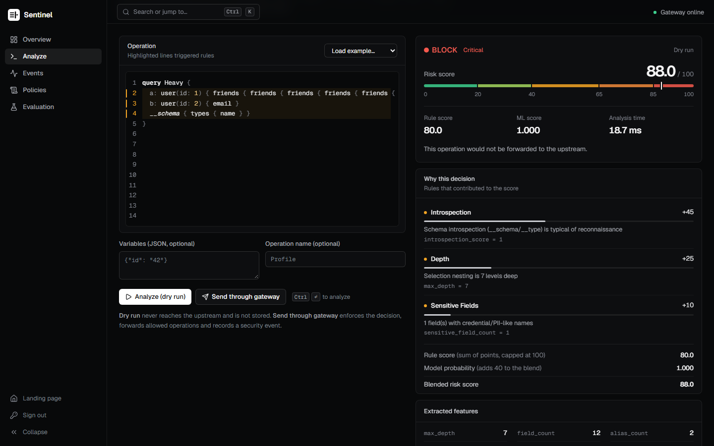<br><sub><b>Analyze</b>: paste an operation, see the lines and rules that drove the score.</sub></td>
    <td width="50%">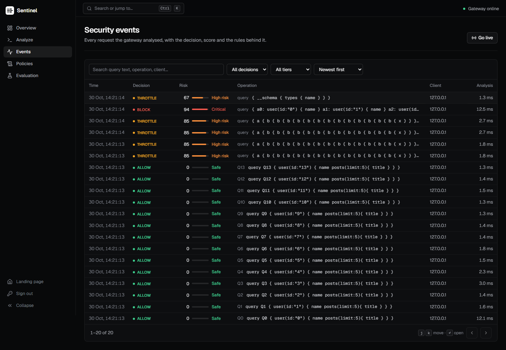<br><sub><b>Events</b>: filter, search, inspect and export the audit trail.</sub></td>
  </tr>
</table>

<details>
<summary><b>More screens</b>: evaluation, policies, access gate, mobile</summary>
<br>

<table>
  <tr>
    <td width="50%">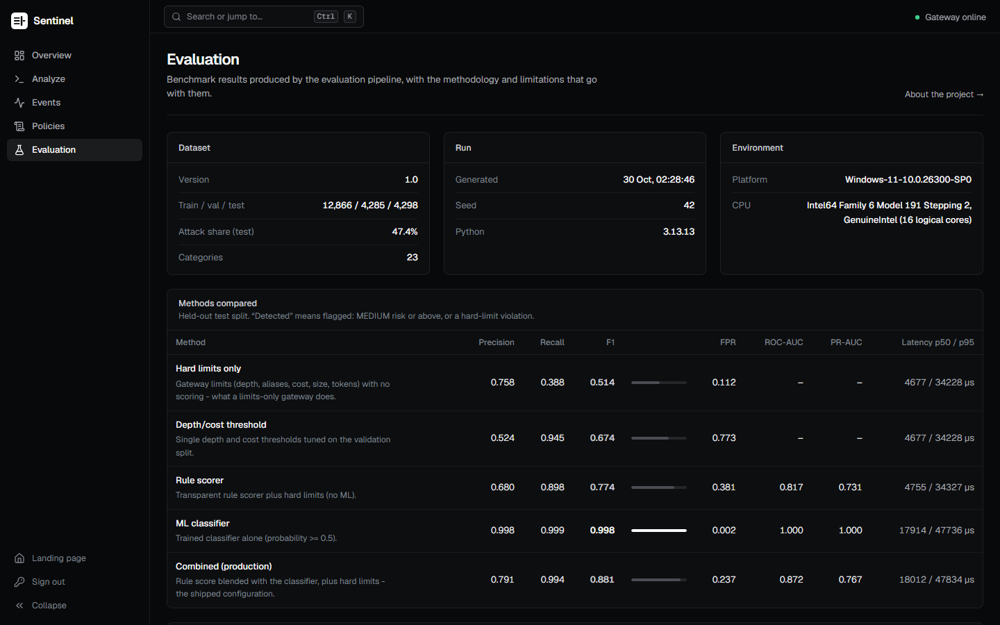<br><sub><b>Evaluation</b>: the benchmark behind the numbers below, rendered from the live report.</sub></td>
    <td width="50%">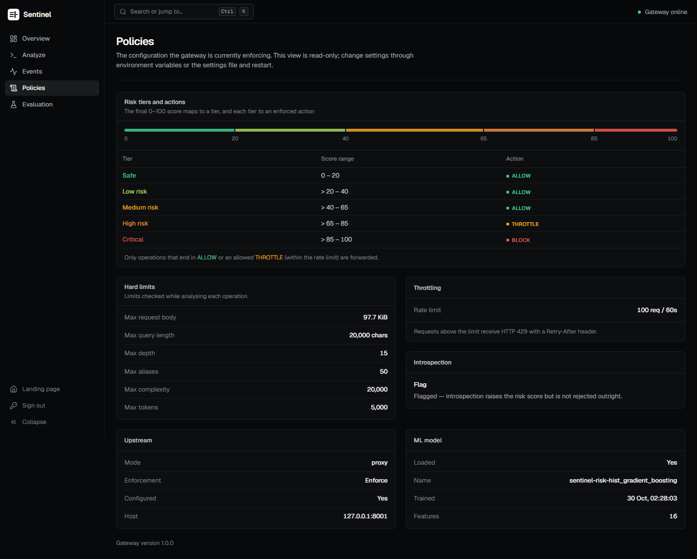<br><sub><b>Policies</b>: the effective limits, tiers and actions (read-only by design).</sub></td>
  </tr>
</table>

<table>
  <tr>
    <td width="33%">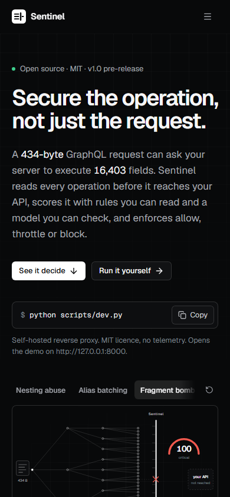</td>
    <td width="33%">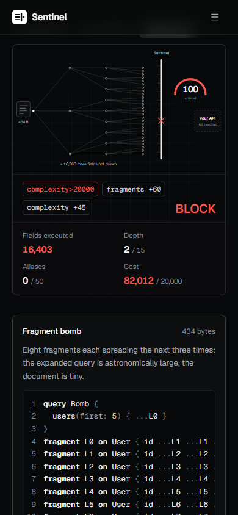</td>
    <td width="33%">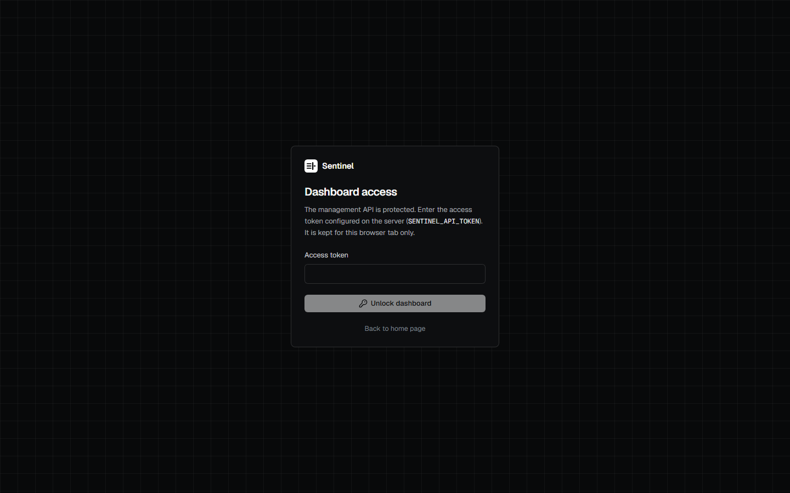</td>
  </tr>
</table>

<sub>Real renders of the running stack, checked at 375 px with no horizontal overflow.</sub>

</details>

<br>

## Quick start

```bash
git clone https://github.com/satyamshrivastav955-dotcom/GraphQL-Sentinel.git
cd GraphQL-Sentinel
pip install -r backend/requirements.txt
python scripts/dev.py
```

That builds the dashboard on first run, starts a demo upstream and the gateway, prints a session access token, and opens
**http://127.0.0.1:8000**: the landing page at `/`, the dashboard at `/app`.

**Try an attack** (the demo upstream is a deliberately unprotected GraphQL server):

```bash
# an ordinary query is forwarded; you get the upstream's real data back
curl -s localhost:8000/graphql-proxy -H 'content-type: application/json' \
  -d '{"query":"{ users(first: 2) { name } }"}'
```
```json
{"data":{"users":[{"name":"User 1"},{"name":"User 2"}]},
 "extensions":{"security":{"decision":"ALLOW","enforced":"forwarded","risk_tier":"SAFE","score":0.0}}}
```
```bash
# an 18-level nested query is blocked and never reaches the upstream (HTTP 403)
curl -s localhost:8000/graphql-proxy -H 'content-type: application/json' \
  -d '{"query":"{ user(id:\"1\") { friends { friends { friends { friends { friends { friends { friends { friends { friends { friends { friends { friends { friends { friends { friends { friends { friends { name } } } } } } } } } } } } } } } } } } }"}'
```
```json
{"data":null,"errors":[{"message":"Operation blocked by security policy"}],
 "extensions":{"security":{"decision":"BLOCK","enforced":"blocked","risk_tier":"CRITICAL","score":97.0,"limit_violations":["max_depth>15"]}}}
```

Then run the whole scenario (legitimate, abusive, throttled, audited) as an end-to-end check:

```bash
SENTINEL_API_TOKEN=<the printed token> python scripts/e2e_check.py
```

<details>
<summary><b>Protect your own API</b></summary>
<br>

```bash
export SENTINEL_UPSTREAM_URL=https://api.example.com/graphql   # the one trusted upstream
export SENTINEL_API_TOKEN=$(python -c "import secrets; print(secrets.token_urlsafe(32))")
export SENTINEL_ENFORCEMENT=shadow                              # record decisions, forward everything
uvicorn backend.main:app --port 8000
```

Roll out safely: run in **shadow mode** first, review what *would* have been blocked in the dashboard and `/metrics`, tune the
limits, then remove the variable to enforce. Without an upstream the gateway answers `503`; it never fakes a success.
See [configuration](docs/configuration.md) and the [rollout guide](docs/deployment.md#recommended-rollout-for-a-real-api).

</details>

<details>
<summary><b>Docker</b> (not yet verified, see <a href="docs/deployment.md">deployment</a>)</summary>
<br>

```bash
cp .env.example .env        # set SENTINEL_API_TOKEN (>= 16 characters)
docker compose up --build   # gateway + dashboard on http://localhost:8080
```

The compose file, Dockerfiles, nginx and Caddy configs have been reviewed but **never executed** by the author yet. Treat them
as a starting point and follow the verification steps in [docs/deployment.md](docs/deployment.md).

</details>

<br>

## How it works


| Stage | What happens |
|---|---|
| **Limits** | Body size, rate per IP, token budget. A parser that could be crashed by input is itself a target, so these run first. |
| **Parse and resolve** | A real GraphQL parser builds the AST. Fragments are resolved (memoised, so a fragment bomb costs microseconds, cycles are detected, depth hidden behind fragments is counted). |
| **Features** | Depth, aliases, fields, directives, introspection, sensitive fields, and a cost model with list-size multipliers. |
| **Score** | A 0-100 rule score where **every point is attributed to a rule**, blended with a checksummed ML model. Hard limits always block and can only raise severity. |
| **Policy and enforce** | Risk tier → `ALLOW`, `THROTTLE` (small per-client quota, then `429`) or `BLOCK` (`403`, never forwarded). Shadow mode records the decision but forwards. |
| **Audit** | One event per request: decision, score, features, explanations, latency. Credentials are redacted; variables are never stored. |

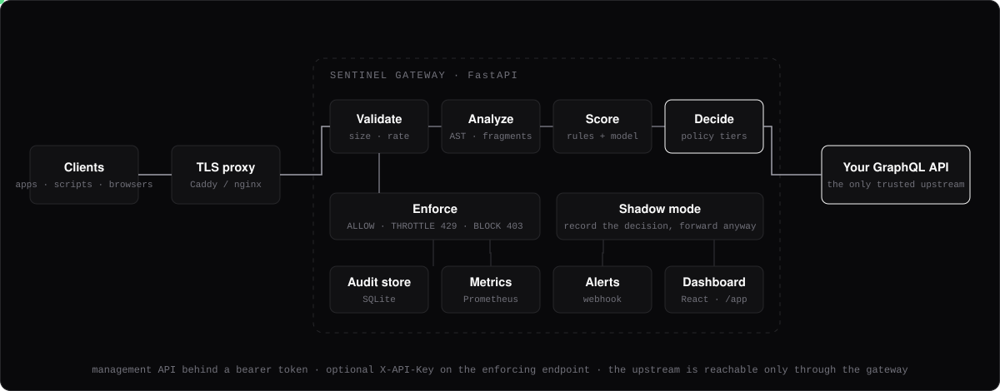

<br>

## Results


The shipped combination beats limits-only (F1 0.51) and a tuned depth/cost threshold (0.67). The model alone looks perfect
in-distribution, and that is exactly the trap:


When a whole attack category is withheld from training, the model alone misses it entirely for several categories
(field duplication, wide selections), while the rules keep working. That is why the production score is a **blend whose weight was
chosen on withheld categories**, with rules keeping the final say on very high scores.

> [!IMPORTANT]
> These are **synthetic** operations from one fictional schema, labelled by generator intent; some design choices were revised after
> seeing earlier aggregate results (disclosed in the report). They are a development benchmark, **not** a prediction of production
> accuracy. On 208 real benign GraphQL queries the shipped scorer flags 3.4%.
> Full tables, methodology and limitations: [docs/evaluation.md](docs/evaluation.md) · [`ml/reports/evaluation.md`](ml/reports/evaluation.md).
> Regenerate everything with `python -m ml.run`.

**Performance** (single gateway process, load generator on the same machine, [details](docs/performance.md)):

| Concurrency | Throughput | p50 | p95 | Errors |
|---|---|---|---|---|
| 1 | 77 req/s | 11 ms | 23 ms | 0 |
| 4 | 177 req/s | 20 ms | 42 ms | 0 |
| 32 | 162 req/s | 171 ms (queueing) | 412 ms | 0 |

<br>

## Features

| | |
|---|---|
| **Operation-aware analysis** | Real parser, fragment-aware depth/field/alias/cost features, fragment bombs and cycles handled in linear time. |
| **Explainable decisions** | Every point of the score is attributed; every event shows the rules and feature values behind it. |
| **Real enforcement** | `BLOCK` never reaches the upstream; `THROTTLE` is a per-client quota with `429` and `Retry-After`; allowed operations return the upstream's real response. |
| **Safe rollout** | Shadow mode, per-limit configuration, an `allow / flag / block` introspection policy. |
| **Operations** | Prometheus `/metrics`, Slack-compatible webhook alerts, CSV/JSON export, live event stream, [OpenAPI](docs/openapi.json). |
| **Hardened by default** | Token-protected management API with lockout, optional API keys for the enforcing endpoint, security headers, fail-closed behaviour, bounded memory, credential redaction. |
| **Honest evaluation** | Reproducible pipeline, independent confirmation set, leave-one-category-out generalisation, disclosed limitations. |

<br>

## Documentation

| | |
|---|---|
| [Architecture](docs/architecture.md) | Request flow, modules, design decisions |
| [Scoring](docs/scoring.md) | Features, rule points, the model blend, tiers |
| [API](docs/api.md) · [OpenAPI](docs/openapi.json) | Endpoints, auth, shadow mode, metrics |
| [Configuration](docs/configuration.md) | Every setting and environment variable |
| [Deployment](docs/deployment.md) | Security review, rollout, Docker verification, public deployment |
| [Threat model](docs/threat-model.md) · [SECURITY](SECURITY.md) | What it protects, assumptions, reporting |
| [Evaluation](docs/evaluation.md) · [Performance](docs/performance.md) | Method, results, load test |
| [Product readiness](docs/product-readiness.md) | What a real v1 still needs |
| [Article draft](docs/article-draft.md) · [Demo walkthrough](docs/demo-walkthrough.md) | Write-up and a 3-minute tour |

<details>
<summary><b>Repository layout</b></summary>
<br>

| Path | Contents |
|---|---|
| `backend/` | FastAPI gateway, analyzer, scoring, limits, policy, runtime stores, tests |
| `dashboard/` | React + TypeScript landing page and dashboard (Vite) |
| `ml/` | Dataset generator, training, evaluation, reports, dataset and model cards |
| `demo/upstream/` | Intentionally unprotected GraphQL server used as the demo target |
| `scripts/` | `dev.py`, `e2e_check.py`, `loadtest.py`, asset and spec generators |
| `deploy/`, `docker/` | Caddy TLS overlay, nginx and Dockerfiles (not yet executed) |

</details>

<details>
<summary><b>Development</b></summary>
<br>

```bash
pip install -r backend/requirements-dev.txt
cd dashboard && npm ci && cd ..
make check            # ruff, backend tests with the coverage gate, dashboard lint/typecheck/tests/build
make ml               # retrain and re-evaluate (a few minutes)
python scripts/build_readme_assets.py   # regenerate the graphics in this README from the real reports
```

`make help` lists everything. See [CONTRIBUTING](CONTRIBUTING.md).

</details>

<br>

## Honest limits

- **Not production-ready yet.** Docker, nginx and Caddy have never been run; there is no validation on real traffic, rate-limit state is per
  process, and the management API uses one shared token with no roles. [docs/product-readiness.md](docs/product-readiness.md) lists what a v1 needs.
- **Not a WAF and not an authorisation layer.** It detects operation-level abuse: nesting, fragments, aliases, cost, introspection, batching.
  Broken access control and resolver injection are out of scope.
- **Detection is statistical.** Expect false positives on unusually heavy but legitimate queries; tune the limits to your API and use shadow mode first.

<br>

## Contributing, security and licence

Contributions are welcome: see [CONTRIBUTING](CONTRIBUTING.md) and the [code of conduct](CODE_OF_CONDUCT.md). Report vulnerabilities privately
via [SECURITY](SECURITY.md). Source code, documentation and generated reports are [MIT](LICENSE) licensed, copyright (c) 2025-2026
Satyam Santosh Shrivastav; third-party material is listed in [NOTICE](NOTICE.md) (the NL2GQL test-set file has unverified provenance and is
excluded from the grant).

<div align="center">
<br>
<sub>Built by <a href="https://github.com/satyamshrivastav955-dotcom">Satyam Santosh Shrivastav</a></sub>
</div>
